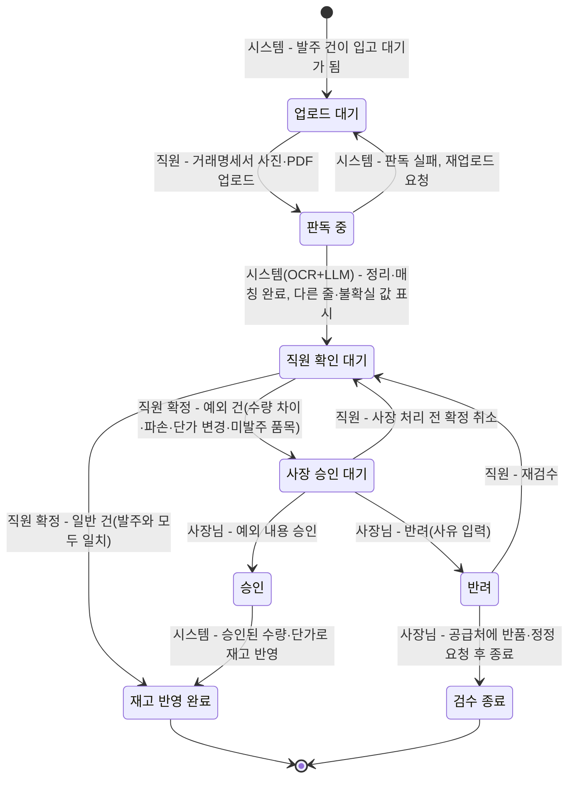

# 3. 규칙, 상태 전이, LLM이 들어갈 자리

> 목표: 클라이언트가 "이 경우엔요?"라고 물을 지점을 우리가 먼저 찾는다. 세부 주제의 필수 조건 두 가지(상태 전이, LLM)가 이 도메인의 어디에 들어갈 수 있는지 찾는다.

## 3-1. 규칙 (최소 5개)

> 규칙은 '항상 / 절대 / ~이면 ~한다' 형태로 씁니다. 예외는 '그런데 만약 ~라면?'으로 찾습니다.
> 예: "배송중이 된 주문은 셀러가 취소할 수 없다" → 만약 고객이 배송중에 취소를 요청하면?

| 번호 | 규칙 | 예외·경계 사례 (만약 ~라면?) | 어기면 생기는 문제 | 태그 | 출처 (카드 번호) |
| --- | --- | --- | --- | --- | --- |
| R1 | 가진 재고보다 많이 출고하려 하면 재고 부족 경고를 보여 준다 | 경고를 무시하고 출고하면? (박스히어로는 이때 재고가 음수가 됨) | 장부와 실제 재고가 맞지 않아 매입 판단이 틀어짐 | [사실] | 4-shusbox-1 |
| R2 | 재고가 정해 둔 안전재고 이하로 떨어지면 알림을 보낸다 (안전재고 0이면 다 팔렸을 때) | 입고 예정이 잡혀 있어 곧 들어올 상품이라면 '품절'인가 '입고 예정'인가? | 품절을 늦게 알아채서 판매 기회를 놓침 | [사실] | 1-shusbox-2 |
| R3 | 발주서만 쓴 단계에서는 재고가 바뀌지 않고, 실제로 입고 처리해야 재고에 더해진다 | 주문한 수량보다 적게 오거나 파손된 채로 납품되면? (부분 입고로 검수) | 받지도 않은 물건이 재고로 잡혀 품절을 놓침 | [사실] | https://www.boxhero.io/docs/ko/faq/inventory-and-transactions/orders |
| R4 | 매입한 물건을 반품하면 반품 수량만큼 재고에서 뺀다 | 검수 전에 불량을 발견해서 입고 없이 바로 돌려보내야 한다면? | 이미 돌려보낸 물건이 재고로 남아 있음 | [사실] | https://www.boxhero.io/docs/ko/faq/inventory-and-transactions/orders |
| R5 | 경쟁 가게를 밀어내려고 원가보다 크게 낮은 가격으로 계속 팔면 안 된다 (부당염매) | 재고 정리를 위해 잠깐 원가 아래로 파는 건? (낮게 파는 것 자체는 항상 위법은 아님. 목적과 기간이 중요함) | 공정거래법 위반으로 규제받을 수 있음 | [사실] | https://dic.hankyung.com/economy/view/?seq=1035 |
| R6 | 상품마다 박스당 개수(환산 기준)를 등록해 두고, 명세서·발주에 박스 단위로 적힌 수량은 이 기준으로 낱개 수량으로 바꿔 재고에 반영한다 | 공급처가 박스 구성을 바꿨는데 등록된 환산 기준을 갱신하지 않았다면? 명세서에 박스·낱개가 섞여 적혀 있다면 어떻게 구분하는가? | 박스 수량을 낱개로(또는 반대로) 착각해 실제보다 몇 배 많거나 적은 재고로 기록됨 | [가정] | 인터뷰 피드백 — 환산 기준을 못 찾은 상품의 처리 방식은 클라이언트 질문 필요 (5-5 추가 필요) |
| R7 | 한 번의 발주에서 특정 상품 수량이 정해 둔 한도를 넘으면 승인 전에 경고를 보여 주고 다시 확인하게 한다 | 특판·행사 등으로 평소보다 많이 주문해야 한다면? 한도를 넘겨도 그대로 승인할 수 있게 둘 것인가? | 오타나 착오로 지나치게 많은 수량을 발주해 과잉 재고와 자금 부담이 생김 | [가정] | 인터뷰 피드백 — 초과 기준값(배수·개수)이 정해지지 않음, 클라이언트 질문 필요 (5-5 추가 필요) |
| R8 | 명세서에 적힌 단가가 등록해 둔 매입 단가보다 일정 비율 이상 높으면 입고 확정 전에 강조해서 보여 준다 | 공급처가 정식으로 단가 인상을 통보한 경우라면 매번 경고가 뜨는 게 맞는가? 등록된 단가는 언제 갱신하는가? | 오른 단가를 놓쳐 손해를 보거나, 판독 오류로 단가가 잘못 찍혀도 그대로 확정됨 | [가정] | 인터뷰 피드백 — 허용 오차 비율이 정해지지 않음, 클라이언트 질문 필요 (5-5 추가 필요) |
| R9 | 명세서에서 읽은 품목이 등록된 상품 목록과 매칭되지 않으면 자동으로 아무 상품에나 연결하지 않고, 직원이 기존 상품을 고르거나 새 상품으로 등록하게 한다 | 이름이 비슷한 상품이 여러 개 있으면 어떤 것을 후보로 보여 주는가? 매칭 후보를 아예 못 찾으면 바로 신규 등록으로 넘어가는가? | 다른 상품으로 잘못 연결돼 재고·단가가 틀어지거나, 실제로는 새 상품인데 재고가 전혀 반영되지 않음 | [가정] | 인터뷰 피드백 — 5-5 Q5(품목명 불일치)와 연결, 매칭 후보 기준은 추가 확인 필요 |
| R10 | LLM이 확신 있게 읽지 못한 줄(흐릿함, 손글씨, 표 밖 메모 등)은 자동으로 채우지 않고 '확인 필요'로 남겨 직원이 직접 입력하게 한다 | 판독 결과가 틀렸는지 애매한지 어떻게 판단하는가? 명세서 일부만 불확실하면 나머지는 그대로 자동 반영해도 되는가? | 틀린 값을 맞다고 믿고 그대로 확정해 재고·단가가 틀어짐 | [가정] | 인터뷰 피드백 — 5-5 Q7(AI 판독 결과 확인)과 연결, 확신도 판단·표시 기준은 추가 확인 필요 |

## 3-2. 핵심 대상과 상태 전이

> **필수 조건입니다.** 세부 주제에는 상태가 바뀌는 핵심 대상이 반드시 있어야 합니다. 핵심 대상 후보를 찾아 상태를 적습니다.
>
> 기준:
> - 상태가 **4개 이상**이고, 처음 상태에서 끝 상태까지 순서가 있습니다.
> - 정상 경로 말고 **취소·반려·되돌림·실패 경로가 1개 이상** 있습니다.
> - 전이마다 **누가 바꾸는지, 어떤 조건에서 바꾸는지** 적을 수 있습니다.
>
> 도메인별 예시 (그대로 쓰지 말고 조사한 내용으로 바꿉니다):
>
> | 도메인 | 핵심 대상 | 상태 흐름 예시 |
> | --- | --- | --- |
> | 오픈마켓 셀러 운영 백오피스 | 주문 | 결제완료 → 상품준비중 → 배송지시 → 배송중 → 배송완료 (취소요청 → 취소완료, 반품요청 → 반품완료) |
> | 러닝 자세·훈련 코칭 | 주간 훈련 계획 | 계획됨 → 진행중 → 기록 제출 → 피드백 완료 (기록 부족 → 재측정 요청) |
> | 다문화 가정 행정 절차 안내 | 절차 진행 건 | 준비중 → 서류 확인 → 제출 완료 → 처리 완료 (서류 부족 → 보완 요청 → 서류 확인) |

**핵심 대상**: 입고 검수 건

발주 건이 `입고 대기`가 되면 그 발주에 연결된 입고 검수 건이 하나 만들어진다. 입고 검수 건이 `재고 반영 완료`가 되어야 발주 건도 `입고 완료`가 된다. 발주를 쓰고 보내는 단계는 재고를 바꾸지 않고(R3), 실제로 재고가 바뀌는 곳은 입고 검수 건이므로 이것을 핵심 대상으로 삼는다.

- **일반 건**: 직원이 확정한 품목·수량·단가가 발주 내용과 모두 같은 건
- **예외 건**: 수량 부족·초과, 파손·불량, 단가 변경, 발주에 없는 품목 중 하나라도 있는 건. 직원이 확정할 때 시스템이 발주 내용과 비교해 자동으로 나눈다.

| 지금 상태 | 다음 상태 | 누가 바꾸나 | 조건 | 되돌릴 수 있나 | 태그 |
| --- | --- | --- | --- | --- | --- |
| (시작) | 업로드 대기 | 시스템 | 연결된 발주 건이 `입고 대기`가 된다. | - | [가정] |
| 업로드 대기 | 판독 중 | 매장 직원 | 납품받은 물건의 거래명세서 사진·PDF를 올린다. | 가능 (판독 전 파일 교체) | [가정] |
| 판독 중 | 직원 확인 대기 | 시스템 (OCR 판독 + LLM 정리·매칭, 3-4 L1) | OCR이 글자를 읽고, LLM이 공통 JSON 필드로 정리하고 품목 후보를 붙인다. 시스템이 발주 내용과 다른 줄과 불확실한 값을 표시한다. | - | [가정] |
| 판독 중 | 업로드 대기 | 시스템 | 사진이 흐리거나 잘려서 판독에 실패한다. 직원에게 다시 올려 달라고 알린다. | - | [가정] |
| 직원 확인 대기 | 재고 반영 완료 | 매장 직원 (확정) → 시스템 (반영) | **일반 건**: 직원이 실물과 대조해 고친 뒤 확정하고, 확정 내용이 발주와 모두 같다. 시스템이 확정 수량만큼 재고에 더한다. | 불가 (고치려면 재고 조정으로 따로 처리) | [가정] |
| 직원 확인 대기 | 사장 승인 대기 | 매장 직원 (확정) → 시스템 (분류) | **예외 건**: 직원이 확정한 내용에 수량 차이·파손·단가 변경·발주에 없는 품목이 있다. 직원은 예외 사유(사진 포함)를 적는다. 재고는 아직 바뀌지 않는다. | 가능 (아래 확정 취소) | [가정] |
| 사장 승인 대기 | 직원 확인 대기 | 매장 직원 | 사장님이 처리하기 전에 직원이 잘못 확정한 것을 알아채고 확정을 취소한다. | - | [가정] |
| 사장 승인 대기 | 승인 | 매장 사장님 | 예외 내용을 확인하고 받아들인다 (예: 부분 입고 인정, 바뀐 단가 수용). | 불가 | [가정] |
| 승인 | 재고 반영 완료 | 시스템 | 사장님이 승인한 수량·단가로 재고와 매입 단가를 반영한다. 모자란 수량은 발주 건에 미입고로 남긴다. | 불가 (고치려면 재고 조정으로 따로 처리) | [가정] |
| 사장 승인 대기 | 반려 | 매장 사장님 | 예외 내용을 받아들이지 않는다 (예: 파손품 반품, 단가 오류). 반려 사유를 적는다. 재고는 바뀌지 않는다. | - | [가정] |
| 반려 | 직원 확인 대기 | 매장 직원 | 사장님이 다시 세어 보라고 했거나 판독 수정이 필요해서 재검수한다. | - | [가정] |
| 반려 | (끝) 검수 종료 | 매장 사장님 | 공급처에 반품·수량 누락·단가 정정을 알리고 이 검수 건을 닫는다. 다시 납품되면 새 입고 검수 건을 만든다. 불량·수량 부족은 받자마자 알려야 한다 (3-3 상법 제69조). | 불가 | [가정] |



## 3-3. 시간에 따라 달라지는 규칙

> 기한, 마감, 주말·공휴일, 유효기간처럼 시간이 끼는 규칙을 1개 이상 적습니다. 3-2의 상태 전이와 이어지면 더 좋습니다.
> 예: 결제 후 ○영업일 안에 배송지시가 없으면 지연으로 표시한다 / 체류 기간 만료 ○일 전부터 연장 신청을 할 수 있다

| 규칙 | 기준 시간 | 주말·공휴일이면? | 태그 | 출처 (카드 번호) |
| --- | --- | --- | --- | --- |
| 재고가 안전재고 이하로 떨어지면, 정해 둔 시간에 알림을 보낸다 | 사장님이 지정한 알림 시간 (예: 매일 오전 9시) | 쉬는 날에도 알림이 가는가? 가게 휴무일에는 다음 영업일로 미뤄야 하는가? (확인 필요) | [사실] | https://www.boxhero.io/docs/ko/other-features/low-stock-alert |
| 지난 날짜로 입고나 출고를 기록하면, 그 날짜 이후의 재고 수량도 자동으로 다시 계산된다 | 기록한 입출고 날짜 | 영향 없음 (날짜 기준으로 계산) | [사실] | https://www.boxhero.io/docs/ko/key-features/tx |
| 납품받은 물건은 받자마자 검사하고, 불량이나 수량 부족은 즉시 거래처에 알려야 반품이나 값 깎기를 요구할 수 있다 (바로 알 수 없는 불량은 6개월 안) | 물건을 받은 날 | 법에 주말 기준은 없음. '지체 없이'라서 쉬는 날이 끼면 다음 영업일에 바로 검사하는 것으로 정해야 함 (확인 필요) | [사실] | https://casenote.kr/법령/상법/제69조 |

## 3-4. LLM이 들어갈 자리

> **필수 조건입니다.** 세부 주제에는 LLM이 **서비스 기능 안에서** 쓰여야 합니다. 개발할 때 Claude를 쓰는 것은 여기에 해당하지 않습니다. 사용자가 서비스를 쓰는 동안 LLM이 무엇을 해 주는지 찾습니다.
>
> 좋은 자리를 고르는 기준:
> - 지금 사람이 **글을 읽고 쓰거나, 설명을 바꾸거나, 분류하는 데** 시간이 드는 곳 (2-2 As-Is의 문제 지점)
> - LLM이 틀려도 **사람이 확인하거나 규칙으로 걸러 낼 수 있는** 곳
> - 상태를 바꾸는 최종 결정은 **규칙이나 사람**이 하고, LLM은 초안·요약·분류·설명을 맡습니다
>
> 도메인별 예시:
>
> | 도메인 | LLM이 하는 일 | 사람이 확인하는 곳 |
> | --- | --- | --- |
> | 오픈마켓 셀러 운영 백오피스 | 고객 문의를 읽고 유형(취소·반품·배송 문의)을 분류하고 답변 초안 작성 | CS 담당이 고쳐서 보냄. 취소·반품 상태 변경은 규칙대로 |
> | 러닝 자세·훈련 코칭 | 러너가 남긴 훈련 기록과 느낌을 요약하고 다음 주 조정 제안 작성 | 코치가 승인해야 계획에 반영. 통증 언급은 의료 상담 권유로 |
> | 다문화 가정 행정 절차 안내 | 공식 안내문을 이용자의 언어와 쉬운 말로 바꾸고, 필요한 서류 목록을 뽑기 | 상담원이 원문과 비교해 확인. 법적 판단은 하지 않음 |

| 후보 | LLM에 넣는 것 (입력) | LLM이 내놓는 것 (출력) | 누가 보고 확인하나 | 틀리면 생기는 일 | 이어지는 상태 전이 | LLM에 보내면 안 되는 정보 (2-3 개인정보) |
| --- | --- | --- | --- | --- | --- | --- |
| L1 | OCR이 거래명세서 사진·PDF에서 읽어 낸 글자와 위치, 해당 발주 건의 품목·수량 목록, 우리 가게 상품 목록(상품명·규격) | 공통 JSON 필드로 정리한 명세서 내용, 줄마다 우리 상품 후보(최대 3개)와 고른 이유, 확신이 없는 값 표시 | 매장 직원이 입고 확인 화면에서 실물과 대조해 고친 뒤 확정. 예외 건은 사장님이 승인. 재고는 LLM이 아니라 확정·승인 뒤 시스템이 바꿈 | 줄을 잘못 나누거나 수량·단가를 다른 칸에 넣으면 재고와 매입 단가가 틀어짐. 다른 상품으로 매칭되면 품절이 아닌데 추가 발주함 | 판독 중 → 직원 확인 대기 / 판독 실패 → 업로드 대기 (3-2) | 명세서에 적힌 거래처 담당자 이름·연락처, 사업자 정보 → 직원 기기(휴대폰) 안에서 가린 뒤, 공통 JSON에 필요한 데이터만 뽑아 외부로 보냄. 원본 사진은 외부 LLM에 보내지 않음 (온디바이스 마스킹) |
| L2 | 규칙·예측이 계산한 품목별 추천 발주 수량, 최근 판매 추이 요약, 날씨·요일, 유통기한 임박 품목 목록 | ① 추천 수량의 근거를 쉬운 말로 쓴 설명 ② 공급처별 주문 문자·메시지 초안 | 사장님이 수량을 고치고 승인해야 발주 전송. LLM은 수량을 정하지 않고, 초안 속 숫자는 시스템이 계산값과 대조해 다르면 막음 | 설명이 틀리면 사장님이 잘못된 근거로 승인해 과잉·과소 발주. 초안 숫자가 바뀌면 엉뚱한 수량이 주문됨 | 발주 초안 → 승인 대기 → 발주 전송 / 사장님 반려 → 발주 초안 | 거래처 담당자 이름·연락처는 전송 단계에서 시스템이 붙임. 매출 총액·마진은 영업 정보라 필요한 범위만 |

### L1에서 LLM이 맡는 일의 범위

LLM은 **문자를 읽는 일(OCR)을 하지 않는다.** 글자 읽기는 OCR이 하고, LLM은 다음 두 가지만 맡는다.

1. **서식 정리**: 공급처마다 다른 명세서 서식(칸 순서, 열 이름, 합계 위치, 손글씨 메모)을 아래 공통 JSON 필드로 옮긴다.
2. **품목 후보 매칭**: 명세서의 상품명(약칭·규격 표기가 제각각)을 우리 가게 상품 목록과 비교해 후보를 고른다. 최종 선택은 직원이 한다.

공통 JSON 필드 (모든 공급처 명세서를 이 모양으로 맞춘다):

```json
{
  "document_date": "2026-10-20",
  "lines": [
    {
      "raw_name": "서울우유 1L*10",
      "spec": "1L",
      "quantity": 10,
      "unit": "개",
      "unit_price": 2650,
      "amount": 26500,
      "item_candidates": [
        { "item_id": "P-0123", "item_name": "서울우유 1000ml", "reason": "상품명·용량 일치" }
      ],
      "uncertain_fields": []
    }
  ],
  "total_amount": 26500,
  "uncertain_fields": []
}
```

- `uncertain_fields`: LLM이 확신하지 못한 필드 이름 (예: 글자가 번져 `quantity`가 3인지 8인지 모를 때). 값을 추측해서 채우지 않고, 빈 값과 함께 여기에 적는다.
- `item_candidates`: 후보가 없으면 빈 배열로 둔다. LLM이 새 상품을 만들지 않는다.
- 공급처 이름·사업자 정보는 발주 건에 이미 있으므로 필드에 넣지 않는다.

### OCR+규칙 방식과 비교

| 기준 | OCR + 규칙 (서식 템플릿·이름 사전) | OCR + LLM (정리·매칭만) | 태그 |
| --- | --- | --- | --- |
| 새 공급처·새 서식 | 공급처마다 칸 위치 템플릿을 새로 만들어야 함. 서식이 조금만 바뀌어도 깨짐 | 템플릿 없이 같은 JSON 필드로 정리할 수 있음 | [추정] |
| 상품명 매칭 | 이름이 정확히 같거나 사전에 등록된 별칭만 맞춤. "우유1L"과 "서울우유 1000ml"은 놓침 | 약칭·규격 표기 차이를 보고 후보를 제시함 | [추정] |
| 손글씨 | OCR이 9를 p로, 0을 다른 글자로 읽으면 그 값이 그대로 들어감. 규칙은 '숫자 칸에 문자가 있음'으로 실패 처리만 할 수 있음 | 칸의 맥락(수량 칸이므로 숫자, 수량 × 단가 = 금액)을 보고 고친 값을 제안함. 단 OCR 글자와 다른 값은 `uncertain_fields`에 넣어 직원이 확인함 | [가정] |
| 숫자 정확성 | 읽은 숫자를 그대로 옮김. 같은 입력이면 항상 같은 결과 | 숫자를 바꾸거나 없는 줄을 만들 위험이 있음 → 아래 규칙 검증 필요 | [가정] |
| 비용·속도 | 건당 비용이 거의 없고 빠름 | 건당 호출 비용과 대기 시간이 생김 | [추정] |
| 틀렸을 때 원인 찾기 | 어느 규칙이 틀렸는지 바로 보임 | 왜 그렇게 정리했는지 알기 어려움 → `reason`을 남기게 함 | [가정] |

**정리**: 숫자 읽기와 검증은 OCR과 규칙이 맡고, LLM은 서식이 제각각인 부분(정리·매칭)에만 쓴다. 가게가 자주 거래하는 공급처가 적고 서식이 고정이라면 OCR+규칙만으로 충분할 수 있으므로, 실제 명세서 서식이 몇 가지인지 확인이 필요하다.

**LLM을 쓰는 핵심 근거** (클라이언트 미팅 1 피드백 4): ① **발주처마다 명세서 양식이 다르다** — 템플릿을 공급처마다 만들지 않고 같은 JSON 필드로 정리할 수 있다 ② **손글씨가 많다** — OCR이 애매하게 읽은 글자를 칸의 맥락으로 해석해 후보값을 낼 수 있다. 두 근거 모두 아직 [가정]이다. 테스트 범위의 거래처 5곳(식자재 2, 유제품 1, 원두 1, 포장재 1) 명세서로 ⓐ 서로 다른 양식이 몇 가지인지 ⓑ 손글씨로 적힌 칸의 비율과 자주 헷갈리는 글자를 확인한다. 양식이 1~2가지뿐이고 손글씨가 거의 없으면 이 근거는 약해지므로, 4-5 결정 기록의 'LLM 효용' 조건에 따라 F-03 방식을 다시 정한다.

### 안전장치

- **LLM은 재고를 직접 바꾸지 않는다.** LLM의 출력은 `직원 확인 대기` 화면에 보여 줄 초안일 뿐이다. 재고는 직원 확정(일반 건) 또는 사장님 승인(예외 건) 뒤에 시스템이 바꾼다 (3-2).
- **불확실한 값은 사람 검수로 보낸다.** 아래 중 하나라도 해당하면 그 칸을 강조하고, 직원이 직접 입력하거나 확인 표시를 해야 확정할 수 있다.
  - LLM이 `uncertain_fields`에 적은 값
  - 규칙 검증 실패: 수량 × 단가 ≠ 금액, 줄 금액 합 ≠ 합계, OCR 글자에 없는 숫자가 JSON에 있음
  - 품목 후보가 없거나, 후보 2개가 비슷해 하나로 정할 수 없음
  - 발주 내용과 품목·수량·단가가 다름 → 확정하면 예외 건으로 분류되어 사장 승인 대기로 감

### 측정과 기록

> 클라이언트 미팅 1 피드백 8: LLM을 써서 줄어든 비용과 판독 정확도를 한 번만 재지 말고 꾸준히 측정해 남긴다.

| 측정 항목 | 계산 방법 | 어디서 얻나 |
| --- | --- | --- |
| 필드별 정확도 | 판독 원본값이 직원 확정값과 같은 칸 수 ÷ 전체 칸 수 (품목·수량·단위·단가·금액별로 따로) | F-07 변경 이력의 판독 원본값과 직원 수정값 |
| 직원이 고친 줄 비율 | 직원이 한 칸이라도 고친 줄 ÷ 전체 줄 (목표 10% 이하, 4-4 ③) | F-07 변경 이력 |
| 행 누락률 | 판독 결과에 없어 직원이 추가한 줄 ÷ 명세서 전체 줄 | F-07 변경 이력 |
| 건당 LLM 비용·대기 시간 | 명세서 1장당 입력·출력 토큰 수와 호출 비용, 업로드부터 `직원 확인 대기`까지 걸린 시간 | 판독할 때마다 남기는 판독 로그 |
| 처리 시간 단축 | 명세서 1장을 재고에 반영하기까지 걸린 시간. 지금 약 7분(기준서 약 10분)과 비교 (4-4 ①) | 업로드 시각과 확정 시각 (F-07) |
| 비용 절감 효과 | (줄어든 처리 시간 × 인건비) − LLM 호출 비용. OCR+규칙 방식으로 같은 명세서를 처리한 결과와 함께 적는다 | 위 항목을 합쳐 계산 |

- **기록 위치**: 서비스 안에서는 판독 건마다 판독 로그와 F-07 변경 이력에 자동으로 남긴다. 팀은 테스트 기간 동안 주 1회 위 항목을 모아 결정 기록(4-5)의 'LLM 효용' 조건을 다시 볼 근거로 쓴다.
- 인건비 기준값과 집계 주기는 [가정]이며, 실제 수치는 테스트를 시작할 때 정한다.

## 3-5. 법령·통계·보고서로 확인하기

> 팀 합계 3개 이상. 3-1 규칙과 ⑤ 손해처럼 근거가 약한 내용을 자료로 확인합니다. 이 중 1개 이상은 `[추정]`·`[가정]`을 `[사실]`로 바꾸거나, 반대로 틀렸다는 것을 확인한 것이어야 합니다.
> 자료마다 [카드](cards/_template.md)를 한 장씩 만들고, 여기에는 목록만 적습니다. 조항 번호나 숫자는 카드에 자료에 적힌 그대로 옮깁니다.

| 자료 종류 | 카드 번호 | 자료명 (짧게) | 확인한 내용 요지 | 태그 변화 | 반영한 표 |
| --- | --- | --- | --- | --- | --- |
| 서비스 문서 | [4-shusbox-1](cards/4-shusbox-1.md) | Lightspeed 수요예측·추천 발주 | 과거 판매 데이터를 바탕으로 수요를 예측하고 추천 발주 수량을 제시하는 기능을 확인했다. 예측은 참고 정보이며 정확성을 보장하지 않는다는 점도 확인했다. | [추정] → [사실]: 기존 재고관리 서비스에 수요예측과 추천 발주 기능이 있다. 다만 예측의 정확도나 손실 감소 효과까지 확인된 것은 아니다. | 3-4 LLM 후보 검토, 4-1 후보 A |
| 논문 | [1-shusbox-2](cards/1-shusbox-2.md) | Easy-to-use inventory management systems for small companies | 초록에서 재고관리 소프트웨어의 기능, 사용자 반응, 재고모형 적용과 발주·재고보유·품절 비용 절감 가능성을 다룬다. 구체적인 절감 수치는 카드에 기록되어 있지 않다. | [추정] → [사실]: 해당 연구가 재고관리 시스템의 사용자 반응과 비용 절감 가능성을 다뤘다는 점을 확인했다. 당근 판매자에게 같은 효과가 난다는 점은 미확인이다. | 2-2 현재 흐름의 문제 근거, 4-1 후보 A |
| 학위논문 | [5-kimjiwoon3472-3](cards/5-kimjiwoon3472-3.md) | 소비기한을 고려한 신선식품 재고 관리 연구 | 소비기한 내 입고 기준일수를 변수로 두고 신선식품의 발주량·재주문점·발주주기를 연구해 결품과 폐기를 줄이는 재고관리 방안을 제안했다. | [가정] → [사실]: 소비기한과 입고 시점을 함께 고려하는 재고관리 연구가 있음을 확인했다. 실제 현장에서 폐기·결품을 얼마나 줄였는지는 카드 내용만으로 확인할 수 없다. | 3-1 R5 검토, 4-1 후보 B |
