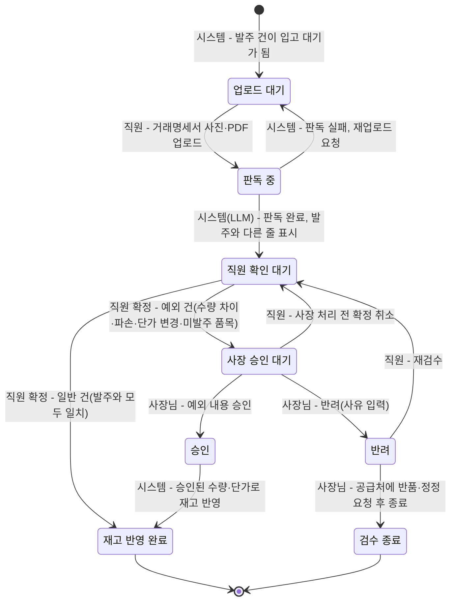

# 3. 규칙, 상태 전이, LLM이 들어갈 자리

> 목표: 클라이언트가 "이 경우엔요?"라고 물을 지점을 우리가 먼저 찾는다. 세부 주제의 필수 조건 두 가지(상태 전이, LLM)가 이 도메인의 어디에 들어갈 수 있는지 찾는다.

## 3-1. 규칙 (최소 5개)

> 규칙은 '항상 / 절대 / ~이면 ~한다' 형태로 씁니다. 예외는 '그런데 만약 ~라면?'으로 찾습니다.
> 예: "배송중이 된 주문은 셀러가 취소할 수 없다" → 만약 고객이 배송중에 취소를 요청하면?

| 번호 | 규칙 | 예외·경계 사례 (만약 ~라면?) | 어기면 생기는 문제 | 태그 | 출처 (카드 번호) |
| --- | --- | --- | --- | --- | --- |
| R1 | 가진 재고보다 많이 출고하려 하면 재고 부족 경고를 보여 준다 | 경고를 무시하고 출고하면? (박스히어로는 이때 재고가 음수가 됨) | 장부와 실제 재고가 맞지 않아 매입 판단이 틀어짐 | [사실] | 4-shusbox-1 |
| R2 | 재고가 정해 둔 안전재고 이하로 떨어지면 알림을 보낸다 (안전재고 0이면 다 팔렸을 때) | 입고 예정이 잡혀 있어 곧 들어올 상품이라면 '품절'인가 '입고 예정'인가? | 품절을 늦게 알아채서 판매 기회를 놓침 | [사실] | 1-shusbox-2 |
| R3 | 발주서만 쓴 단계에서는 재고가 바뀌지 않고, 실제로 입고 처리해야 재고에 더해진다 | 주문한 수량보다 적게 오거나 파손된 채로 납품되면? (부분 입고로 검수) | 받지도 않은 물건이 재고로 잡혀 품절을 놓침 | [사실] | https://www.boxhero.io/docs/ko/faq/inventory-and-transactions/orders |
| R4 | 매입한 물건을 반품하면 반품 수량만큼 재고에서 뺀다 | 검수 전에 불량을 발견해서 입고 없이 바로 돌려보내야 한다면? | 이미 돌려보낸 물건이 재고로 남아 있음 | [사실] | https://www.boxhero.io/docs/ko/faq/inventory-and-transactions/orders |
| R5 | 경쟁 가게를 밀어내려고 원가보다 크게 낮은 가격으로 계속 팔면 안 된다 (부당염매) | 재고 정리를 위해 잠깐 원가 아래로 파는 건? (낮게 파는 것 자체는 항상 위법은 아님. 목적과 기간이 중요함) | 공정거래법 위반으로 규제받을 수 있음 | [사실] | https://dic.hankyung.com/economy/view/?seq=1035 |

## 3-2. 핵심 대상과 상태 전이

> **필수 조건입니다.** 세부 주제에는 상태가 바뀌는 핵심 대상이 반드시 있어야 합니다. 핵심 대상 후보를 찾아 상태를 적습니다.
>
> 기준:
> - 상태가 **4개 이상**이고, 처음 상태에서 끝 상태까지 순서가 있습니다.
> - 정상 경로 말고 **취소·반려·되돌림·실패 경로가 1개 이상** 있습니다.
> - 전이마다 **누가 바꾸는지, 어떤 조건에서 바꾸는지** 적을 수 있습니다.
>
> 도메인별 예시 (그대로 쓰지 말고 조사한 내용으로 바꿉니다):
>
> | 도메인 | 핵심 대상 | 상태 흐름 예시 |
> | --- | --- | --- |
> | 오픈마켓 셀러 운영 백오피스 | 주문 | 결제완료 → 상품준비중 → 배송지시 → 배송중 → 배송완료 (취소요청 → 취소완료, 반품요청 → 반품완료) |
> | 러닝 자세·훈련 코칭 | 주간 훈련 계획 | 계획됨 → 진행중 → 기록 제출 → 피드백 완료 (기록 부족 → 재측정 요청) |
> | 다문화 가정 행정 절차 안내 | 절차 진행 건 | 준비중 → 서류 확인 → 제출 완료 → 처리 완료 (서류 부족 → 보완 요청 → 서류 확인) |

**핵심 대상**: 입고 검수 건

발주 건이 `입고 대기`가 되면 그 발주에 연결된 입고 검수 건이 하나 만들어진다. 입고 검수 건이 `재고 반영 완료`가 되어야 발주 건도 `입고 완료`가 된다. 발주를 쓰고 보내는 단계는 재고를 바꾸지 않고(R3), 실제로 재고가 바뀌는 곳은 입고 검수 건이므로 이것을 핵심 대상으로 삼는다.

- **일반 건**: 직원이 확정한 품목·수량·단가가 발주 내용과 모두 같은 건
- **예외 건**: 수량 부족·초과, 파손·불량, 단가 변경, 발주에 없는 품목 중 하나라도 있는 건. 직원이 확정할 때 시스템이 발주 내용과 비교해 자동으로 나눈다.

| 지금 상태 | 다음 상태 | 누가 바꾸나 | 조건 | 되돌릴 수 있나 | 태그 |
| --- | --- | --- | --- | --- | --- |
| (시작) | 업로드 대기 | 시스템 | 연결된 발주 건이 `입고 대기`가 된다. | - | [가정] |
| 업로드 대기 | 판독 중 | 매장 직원 | 납품받은 물건의 거래명세서 사진·PDF를 올린다. | 가능 (판독 전 파일 교체) | [가정] |
| 판독 중 | 직원 확인 대기 | 시스템 (LLM 판독, 3-4 L1) | 명세서에서 품목·수량·단가 표를 읽어 내고, 발주 내용과 다른 줄을 표시한다. | - | [가정] |
| 판독 중 | 업로드 대기 | 시스템 | 사진이 흐리거나 잘려서 판독에 실패한다. 직원에게 다시 올려 달라고 알린다. | - | [가정] |
| 직원 확인 대기 | 재고 반영 완료 | 매장 직원 (확정) → 시스템 (반영) | **일반 건**: 직원이 실물과 대조해 고친 뒤 확정하고, 확정 내용이 발주와 모두 같다. 시스템이 확정 수량만큼 재고에 더한다. | 불가 (고치려면 재고 조정으로 따로 처리) | [가정] |
| 직원 확인 대기 | 사장 승인 대기 | 매장 직원 (확정) → 시스템 (분류) | **예외 건**: 직원이 확정한 내용에 수량 차이·파손·단가 변경·발주에 없는 품목이 있다. 직원은 예외 사유(사진 포함)를 적는다. 재고는 아직 바뀌지 않는다. | 가능 (아래 확정 취소) | [가정] |
| 사장 승인 대기 | 직원 확인 대기 | 매장 직원 | 사장님이 처리하기 전에 직원이 잘못 확정한 것을 알아채고 확정을 취소한다. | - | [가정] |
| 사장 승인 대기 | 승인 | 매장 사장님 | 예외 내용을 확인하고 받아들인다 (예: 부분 입고 인정, 바뀐 단가 수용). | 불가 | [가정] |
| 승인 | 재고 반영 완료 | 시스템 | 사장님이 승인한 수량·단가로 재고와 매입 단가를 반영한다. 모자란 수량은 발주 건에 미입고로 남긴다. | 불가 (고치려면 재고 조정으로 따로 처리) | [가정] |
| 사장 승인 대기 | 반려 | 매장 사장님 | 예외 내용을 받아들이지 않는다 (예: 파손품 반품, 단가 오류). 반려 사유를 적는다. 재고는 바뀌지 않는다. | - | [가정] |
| 반려 | 직원 확인 대기 | 매장 직원 | 사장님이 다시 세어 보라고 했거나 판독 수정이 필요해서 재검수한다. | - | [가정] |
| 반려 | (끝) 검수 종료 | 매장 사장님 | 공급처에 반품·수량 누락·단가 정정을 알리고 이 검수 건을 닫는다. 다시 납품되면 새 입고 검수 건을 만든다. 불량·수량 부족은 받자마자 알려야 한다 (3-3 상법 제69조). | 불가 | [가정] |

## 3-3. 시간에 따라 달라지는 규칙

> 기한, 마감, 주말·공휴일, 유효기간처럼 시간이 끼는 규칙을 1개 이상 적습니다. 3-2의 상태 전이와 이어지면 더 좋습니다.
> 예: 결제 후 ○영업일 안에 배송지시가 없으면 지연으로 표시한다 / 체류 기간 만료 ○일 전부터 연장 신청을 할 수 있다

| 규칙 | 기준 시간 | 주말·공휴일이면? | 태그 | 출처 (카드 번호) |
| --- | --- | --- | --- | --- |
| 재고가 안전재고 이하로 떨어지면, 정해 둔 시간에 알림을 보낸다 | 사장님이 지정한 알림 시간 (예: 매일 오전 9시) | 쉬는 날에도 알림이 가는가? 가게 휴무일에는 다음 영업일로 미뤄야 하는가? (확인 필요) | [사실] | https://www.boxhero.io/docs/ko/other-features/low-stock-alert |
| 지난 날짜로 입고나 출고를 기록하면, 그 날짜 이후의 재고 수량도 자동으로 다시 계산된다 | 기록한 입출고 날짜 | 영향 없음 (날짜 기준으로 계산) | [사실] | https://www.boxhero.io/docs/ko/key-features/tx |
| 납품받은 물건은 받자마자 검사하고, 불량이나 수량 부족은 즉시 거래처에 알려야 반품이나 값 깎기를 요구할 수 있다 (바로 알 수 없는 불량은 6개월 안) | 물건을 받은 날 | 법에 주말 기준은 없음. '지체 없이'라서 쉬는 날이 끼면 다음 영업일에 바로 검사하는 것으로 정해야 함 (확인 필요) | [사실] | https://casenote.kr/법령/상법/제69조 |

## 3-4. LLM이 들어갈 자리

> **필수 조건입니다.** 세부 주제에는 LLM이 **서비스 기능 안에서** 쓰여야 합니다. 개발할 때 Claude를 쓰는 것은 여기에 해당하지 않습니다. 사용자가 서비스를 쓰는 동안 LLM이 무엇을 해 주는지 찾습니다.
>
> 좋은 자리를 고르는 기준:
> - 지금 사람이 **글을 읽고 쓰거나, 설명을 바꾸거나, 분류하는 데** 시간이 드는 곳 (2-2 As-Is의 문제 지점)
> - LLM이 틀려도 **사람이 확인하거나 규칙으로 걸러 낼 수 있는** 곳
> - 상태를 바꾸는 최종 결정은 **규칙이나 사람**이 하고, LLM은 초안·요약·분류·설명을 맡습니다
>
> 도메인별 예시:
>
> | 도메인 | LLM이 하는 일 | 사람이 확인하는 곳 |
> | --- | --- | --- |
> | 오픈마켓 셀러 운영 백오피스 | 고객 문의를 읽고 유형(취소·반품·배송 문의)을 분류하고 답변 초안 작성 | CS 담당이 고쳐서 보냄. 취소·반품 상태 변경은 규칙대로 |
> | 러닝 자세·훈련 코칭 | 러너가 남긴 훈련 기록과 느낌을 요약하고 다음 주 조정 제안 작성 | 코치가 승인해야 계획에 반영. 통증 언급은 의료 상담 권유로 |
> | 다문화 가정 행정 절차 안내 | 공식 안내문을 이용자의 언어와 쉬운 말로 바꾸고, 필요한 서류 목록을 뽑기 | 상담원이 원문과 비교해 확인. 법적 판단은 하지 않음 |

| 후보 | LLM에 넣는 것 (입력) | LLM이 내놓는 것 (출력) | 누가 보고 확인하나 | 틀리면 생기는 일 | 이어지는 상태 전이 | LLM에 보내면 안 되는 정보 (2-3 개인정보) |
| --- | --- | --- | --- | --- | --- | --- |
| L1 | 공급처 거래명세서 사진·PDF와 해당 발주 건의 품목·수량 목록 | 상품명·수량·단가 표, 발주 내용과 다른 줄 표시 | 매장 직원이 입고 확인 화면에서 실물과 대조해 고친 뒤 확정. 재고 수량은 직원이 확정해야만 바뀜 | 수량·단가를 잘못 읽으면 재고와 매입 단가가 틀어짐. 다른 상품으로 매칭되면 품절이 아닌데 추가 발주함 | 발주 전송 → 입고 확인중 → 입고 완료 / 부분 입고 → 공급처에 누락 문의 | 명세서에 적힌 거래처 담당자 이름·연락처, 사업자 정보 → 보내기 전에 지우거나 가림 |
| L2 | 규칙·예측이 계산한 품목별 추천 발주 수량, 최근 판매 추이 요약, 날씨·요일, 유통기한 임박 품목 목록 | ① 추천 수량의 근거를 쉬운 말로 쓴 설명 ② 공급처별 주문 문자·메시지 초안 | 사장님이 수량을 고치고 승인해야 발주 전송. LLM은 수량을 정하지 않고, 초안 속 숫자는 시스템이 계산값과 대조해 다르면 막음 | 설명이 틀리면 사장님이 잘못된 근거로 승인해 과잉·과소 발주. 초안 숫자가 바뀌면 엉뚱한 수량이 주문됨 | 발주 초안 → 승인 대기 → 발주 전송 / 사장님 반려 → 발주 초안 | 거래처 담당자 이름·연락처는 전송 단계에서 시스템이 붙임. 매출 총액·마진은 영업 정보라 필요한 범위만 |

## 3-5. 법령·통계·보고서로 확인하기

> 팀 합계 3개 이상. 3-1 규칙과 ⑤ 손해처럼 근거가 약한 내용을 자료로 확인합니다. 이 중 1개 이상은 `[추정]`·`[가정]`을 `[사실]`로 바꾸거나, 반대로 틀렸다는 것을 확인한 것이어야 합니다.
> 자료마다 [카드](cards/_template.md)를 한 장씩 만들고, 여기에는 목록만 적습니다. 조항 번호나 숫자는 카드에 자료에 적힌 그대로 옮깁니다.

| 자료 종류 | 카드 번호 | 자료명 (짧게) | 확인한 내용 요지 | 태그 변화 | 반영한 표 |
| --- | --- | --- | --- | --- | --- |
| 서비스 문서 | [4-shusbox-1](cards/4-shusbox-1.md) | Lightspeed 수요예측·추천 발주 | 과거 판매 데이터를 바탕으로 수요를 예측하고 추천 발주 수량을 제시하는 기능을 확인했다. 예측은 참고 정보이며 정확성을 보장하지 않는다는 점도 확인했다. | [추정] → [사실]: 기존 재고관리 서비스에 수요예측과 추천 발주 기능이 있다. 다만 예측의 정확도나 손실 감소 효과까지 확인된 것은 아니다. | 3-4 LLM 후보 검토, 4-1 후보 A |
| 논문 | [1-shusbox-2](cards/1-shusbox-2.md) | Easy-to-use inventory management systems for small companies | 초록에서 재고관리 소프트웨어의 기능, 사용자 반응, 재고모형 적용과 발주·재고보유·품절 비용 절감 가능성을 다룬다. 구체적인 절감 수치는 카드에 기록되어 있지 않다. | [추정] → [사실]: 해당 연구가 재고관리 시스템의 사용자 반응과 비용 절감 가능성을 다뤘다는 점을 확인했다. 당근 판매자에게 같은 효과가 난다는 점은 미확인이다. | 2-2 현재 흐름의 문제 근거, 4-1 후보 A |
| 학위논문 | [5-kimjiwoon3472-3](cards/5-kimjiwoon3472-3.md) | 소비기한을 고려한 신선식품 재고 관리 연구 | 소비기한 내 입고 기준일수를 변수로 두고 신선식품의 발주량·재주문점·발주주기를 연구해 결품과 폐기를 줄이는 재고관리 방안을 제안했다. | [가정] → [사실]: 소비기한과 입고 시점을 함께 고려하는 재고관리 연구가 있음을 확인했다. 실제 현장에서 폐기·결품을 얼마나 줄였는지는 카드 내용만으로 확인할 수 없다. | 3-1 R5 검토, 4-1 후보 B |
